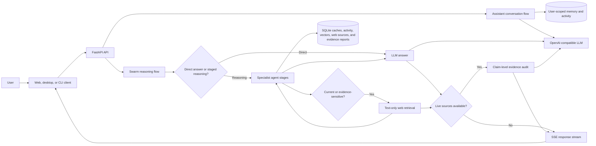

# 10,000-Worker LLM Swarm

This prototype runs an eleven-stage reasoning workflow through a configured LLM provider. For reasoning requests that need current facts, news, or explicit source verification, it conditionally runs an additional web-retrieval stage. A pool of 10,000 lightweight local workers supports selection and planning; the workers themselves are not 10,000 independent LLM sessions.

The planner, optional web retriever, researcher, analyst, critic, executor, synthesizer draft, corrector, synthesizer revision, query-focus agent, response summarizer, and validator run in sequence. Basic/direct questions do not invoke web search. The web retriever uses LangGraph and Tavily to collect attributed text only, then stores user-scoped dense vectors, source text, topic links, and nearest-neighbor graph edges in SQLite. Retrieval combines BM25, dense cosine similarity, and Dijkstra traversal. The query-focus agent preserves the exact request while extracting constraints and comparisons. Authenticated API workflows store per-user agent-output feature vectors separately. The corrector gives evidence-grounded feedback before final validation. The validator returns a model self-assessment, which is not a factual correctness guarantee; web sources are evidence, not proof.

Evidence-sensitive web research now adds a **claim-level Evidence Ledger**. A dedicated auditor labels answer claims as supported, contradicted, mixed, or insufficient evidence and links them to source passages only when the quoted text can be matched against the retrieved source. Reports persist privately per user and can be listed with `GET /api/evidence-ledger`; clearing history also clears them. These are source-based model assessments, not proof of truth. The ledger runs only when live web research ran, and adds one LLM call to those queries.

## Architecture at a glance



See [swarm_architecture.md](swarm_architecture.md) for detailed subsystem flows. [swarm_architecture.mmd](swarm_architecture.mmd) is the standalone Mermaid source for rendering or exporting the overview as SVG/PNG.

## Run the API

Configure `GROQ_API_KEY` in a local `.env` file to run the application. Add `TAVILY_API_KEY` to enable live web retrieval for eligible reasoning requests, then run:

```powershell
docker compose up --build
```

Create an account from the client before running a workflow. Accounts are stored in SQLite and passwords are hashed with Argon2. Set a stable random `JWT_SECRET_KEY` in `.env` for deployments; without it, the API generates a temporary signing key at startup and existing sessions expire when the process restarts. Docker Compose persists the account database in a named volume.

Successful text-only answers are stored in a per-user, per-model local vector cache. Near-identical prompts can return immediately without calling the agent stages. Attachment queries bypass the cache so answers grounded in private files are never reused for a plain-text request.

Web-research queries bypass the answer cache so they can fetch fresh results. Configure `TAVILY_API_KEY` for live search. The first web query downloads the local `BAAI/bge-small-en-v1.5` FastEmbed model; source text and vectors are persisted per user in `web_research.sqlite3` (or `WEB_RESEARCH_DB_PATH`). Clearing history also removes that user's web research records. Search sends only the query text, never attachment contents; avoid including personal or private details in queries. Retrieved source text is treated as untrusted evidence, and citations/uncertainty are required for externally sourced claims.

The client includes a private activity graph of the signed-in user's recent prompts and streamed agent stages. It connects related prompts, links each stage to its source prompt, and exposes context on hover or keyboard focus. Activity records store prompt text, timestamp, model, attachment count, cache status, and up to 320 characters of each stage output; uploaded file contents and final answers are not copied into the activity log. The graph displays the latest 80 prompts and 160 stage events while retaining the full local history.

When the user opens Assistant mode, a dedicated continuity agent uses only that user's saved assistant turns and relevant activity graph to stream a concise, context-aware greeting. If the user stays idle, it can stream up to two grounded follow-up thoughts per open session after 45 seconds; a Pause/Resume control is available in the header. Completed proactive messages are saved to the user's conversation to maintain continuity. Assistant replies stream token by token and are saved only when complete. Proactive behavior runs only while the app session is open; it does not monitor users in the background, search the web on its own, or claim human feelings.

Agent output vectors are separate from the answer cache and activity graph. They are user-scoped, retain up to 5,000 stage outputs per user, and use the project's local hashed lexical feature vectors rather than a hosted embedding service. Set `AGENT_OUTPUT_VECTOR_DB_PATH` to choose another local database file.

The API is at `http://localhost:8000`; interactive docs are at `/docs`. Use `POST /api/swarm/query` for a complete result or `POST /api/swarm/query/stream` for Server-Sent Events after each stage completes.

The GUI and command-line apps also require `GROQ_API_KEY`. For local Python setup and endpoint examples, see [api.md](api.md).

Reasoning queries use a classifier request plus eleven stage requests. Direct-routed queries retain the existing classifier-plus-answer path. Latency, provider quotas, and token costs scale with query volume and configured model limits.
