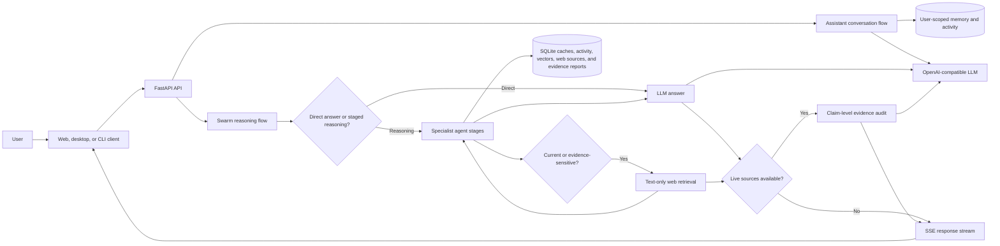

# 10,000-Worker LLM Swarm

This prototype runs an eleven-stage reasoning workflow through a configured LLM provider. For reasoning requests that need current facts, news, or explicit source verification, it conditionally runs an additional web-retrieval stage. A pool of 10,000 lightweight local workers supports selection and planning; the workers themselves are not 10,000 independent LLM sessions.

The planner, optional web retriever, researcher, analyst, critic, executor, synthesizer draft, corrector, synthesizer revision, query-focus agent, response summarizer, and validator run in sequence. Basic/direct questions do not invoke web search. The web retriever uses LangGraph and Tavily to collect attributed text only, then falls back to DuckDuckGo and a bounded HTML search/page scraper if those providers fail. It stores user-scoped dense vectors, source text, topic links, and nearest-neighbor graph edges in SQLite. Retrieval failures for individual queries preserve any recovered sources; if all public retrieval paths fail, the request goes directly through the configured normal LLM gateway, with a clear caveat that current facts could not be verified. Explicit image requests use DDGS to discover public pages, then a bounded crawler extracts image URLs and page attribution from those pages; image files are loaded by the browser and are not downloaded or persisted by the API. DDGS has no API or subscription fee, but its upstream search backends may impose rate limits or change availability. The crawler only fetches public HTTPS pages, follows a limited number of redirects, and caps page size and count. Research mode additionally searches public pages for linked PDF and DOCX documents, extracts bounded text excerpts, and shows the original document and discovery-page links; this document crawler does not run in normal mode. The **Documents** panel is available only while Research mode is active: it can search and review online documents or review user-uploaded PDF/DOCX files. Retrieved document text is treated as untrusted evidence. Retrieval combines BM25, dense cosine similarity, and Dijkstra traversal. The query-focus agent preserves the exact request while extracting constraints and comparisons. Authenticated API workflows store per-user agent-output feature vectors separately. The corrector gives evidence-grounded feedback before final validation. The validator returns a model self-assessment, which is not a factual correctness guarantee; web sources are evidence, not proof.

Evidence-sensitive web research now adds a **claim-level Evidence Ledger**. A dedicated auditor labels answer claims as supported, contradicted, mixed, or insufficient evidence and links them to source passages only when the quoted text can be matched against the retrieved source. Reports persist privately per user and can be listed with `GET /api/evidence-ledger`; clearing history also clears them. These are source-based model assessments, not proof of truth. The ledger runs only when live web research ran, and adds one LLM call to those queries.

## Architecture at a glance



See [swarm_architecture.md](swarm_architecture.md) for detailed subsystem flows. [swarm_architecture.mmd](swarm_architecture.mmd) is the standalone Mermaid source for rendering or exporting the overview as SVG/PNG.

## Run the API

Configure `GROQ_API_KEY` in a local `.env` file to run the application. Add `TAVILY_API_KEY` to enable primary live text search; the retriever falls back to DuckDuckGo when Tavily is unavailable. Image search uses DDGS without a search API key, then run:

```powershell
docker compose up --build
```

Create an account from the client before running a workflow. Password accounts are stored in SQLite and passwords are hashed with Argon2. To enable Google sign-in, create an OAuth 2.0 Web client ID in Google Cloud, add the app's local and deployed origins to its authorized JavaScript origins, and set `GOOGLE_CLIENT_ID` in `.env` (Docker Compose passes it to the API). No Google client secret is required. Google credentials are verified by the API and stored as separate Google accounts; Google sign-in never links to or changes a password account, even when both use the same email address. Users choose their Google account through the Google sign-in button. Set a stable random `JWT_SECRET_KEY` in `.env` for deployments; without it, the API generates a temporary signing key at startup and existing sessions expire when the process restarts. Docker Compose persists the account database in a named volume.

Successful text-only answers are stored in a per-user, per-model local vector cache. Near-identical prompts can return immediately without calling the agent stages. Attachment queries bypass the cache so answers grounded in private files are never reused for a plain-text request.

Web-research queries bypass the answer cache so they can fetch fresh results. Configure `TAVILY_API_KEY` for primary live search; if Tavily is unavailable, the retriever falls back to DuckDuckGo and bounded public HTML text extraction. The first successful web query downloads the local `BAAI/bge-small-en-v1.5` FastEmbed model; source text and vectors are persisted per user in `web_research.sqlite3` (or `WEB_RESEARCH_DB_PATH`). Clearing history also removes that user's web research records. Search sends only the query text, never attachment contents. After model failures, eligible public-information queries may return labeled source excerpts without an AI-generated summary; this fallback is disabled for attachment/image requests and likely private or credential-bearing queries.

Text generation uses `GROQ_MODEL` first and then `GROQ_FALLBACK_MODELS` (default `qwen/qwen3.8-27b` for Groq). Image requests use `GROQ_VISION_MODEL` and only vision-compatible `GROQ_VISION_FALLBACK_MODELS`. Configure model IDs available to your provider account; see [api.md](api.md).

Chat sends up to the eight latest completed user/assistant messages as bounded context. Follow-up questions use that context; when the classifier identifies a clearly unrelated topic, the app drops earlier turns and starts context fresh. Attachments and other message metadata are not included in this history context. The chat context is held in the active browser session and is not restored after a page reload.

The client includes a private activity graph of the signed-in user's recent prompts and streamed agent stages. It connects related prompts, links each stage to its source prompt, and exposes context on hover or keyboard focus. Activity records store prompt text, timestamp, model, attachment count, cache status, and up to 320 characters of each stage output; uploaded file contents and final answers are not copied into the activity log. The graph displays the latest 80 prompts and 160 stage events while retaining the full local history.

Before a final answer is returned from the Swarm workflow or Assistant conversation, a dedicated answer-sanitizer agent removes irrelevant orchestration/configuration chatter and accidental debug noise while preserving relevant technical diagnostics, facts, citations, and requested code. Assistant stream replies are cleaned before any answer text is sent and the cleaned result is what gets saved. When the user opens Assistant mode, a dedicated continuity agent uses only that user's saved assistant turns and relevant activity graph to stream a concise, context-aware greeting. If the user stays idle, it can stream up to two grounded follow-up thoughts per open session after 45 seconds, using related private conversation-vector memories to surface recurring work themes. Proactive replies adapt their tone to emotions clearly expressed in the conversation, remain neutral when cues are ambiguous, and avoid diagnosing or claiming the assistant experiences human feelings. When context is strong enough, it asks whether to take a concrete next task or explore a useful related question. Completed proactive messages are saved to the user's conversation to maintain continuity. Proactive behavior runs only while the app session is open; it does not monitor users in the background, search the web on its own, or claim human feelings, and the saved proactive opt-in is enforced by the API.

Observer mode is a separate opt-in control in Chat. It processes completed chat turns the app owns; it does not capture the desktop or inspect other applications. While enabled, turns are summarized into a private, per-user and per-session context profile and local feature-vector memories without requiring an embedding-model download. Reviewable context cards capture the current topic, goal, explicit decisions, open questions, and a possible next step. Cards can be edited, pinned, or deleted; unpinned cards expire after 30 days, and session data is removed when the user clears history. Context-card vectors use the local hashed lexical feature vector. The Observer can suggest a relevant next thought and search the public web with a generic query; raw chat turns are not sent to the search provider, and related sources are shown separately in the floating panel. Chat turns are sent to the configured LLM provider for extraction and insight generation, so Observer memory being stored locally does not mean model processing is fully offline. This mode is inactive by default.

Agent output vectors are separate from the answer cache and activity graph. They are user-scoped, retain up to 5,000 stage outputs per user, and use the project's local hashed lexical feature vectors rather than a hosted embedding service. Set `AGENT_OUTPUT_VECTOR_DB_PATH` to choose another local database file.

The API is at `http://localhost:8000`; interactive docs are at `/docs`. Use `POST /api/swarm/query` for a complete result or `POST /api/swarm/query/stream` for Server-Sent Events after each stage completes.

Research-mode document endpoints require a signed-in user and `"research_mode": true`: `POST /api/research/documents/search` accepts a query and returns extracted excerpts with exact document and discovery-page URLs; `POST /api/research/documents/review-online` accepts an exact public PDF/DOCX URL for an AI review; `POST /api/research/documents/review` accepts uploaded PDF/DOCX files and review instructions.

The GUI and command-line apps also require `GROQ_API_KEY`. For local Python setup and endpoint examples, see [api.md](api.md).

Reasoning queries use a classifier request plus eleven stage requests. Direct-routed queries retain the existing classifier-plus-answer path. Latency, provider quotas, and token costs scale with query volume and configured model limits.
