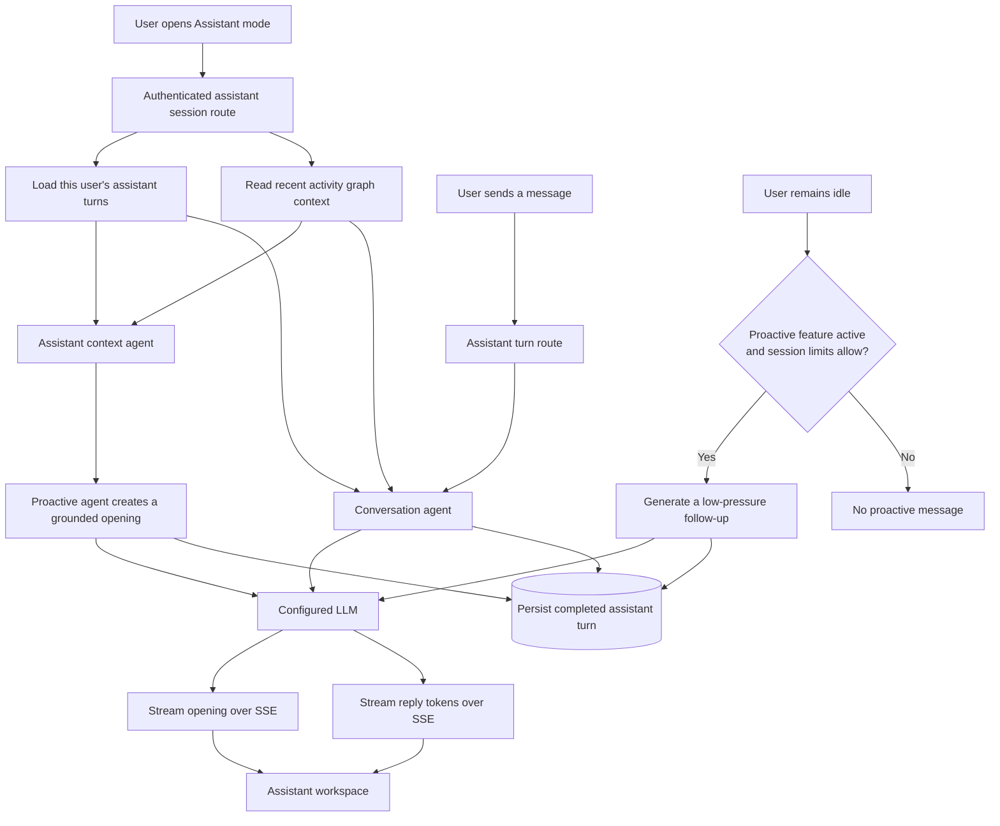
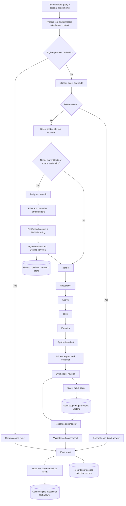

# Project High-Level Architecture

```mermaid
flowchart LR
    user["User"]

    subgraph clients["Client applications"]
        web["Web app<br/>React + Vite"]
        desktop["Desktop visualizer<br/>Tkinter"]
        terminal["CLI / terminal UI"]
    end

    subgraph api["FastAPI service"]
        auth["Authentication<br/>register / login / JWT"]
        api_routes["Authenticated REST API"]
        sse["Server-Sent Events<br/>workflow and assistant streams"]
        assistant_routes["Assistant session, turn,<br/>history and proactive routes"]
        swarm_routes["Swarm query routes<br/>complete or streamed"]
        attachments["Attachment preparation<br/>text / PDF extraction / images"]
    end

    subgraph assistant["Assistant conversation path"]
        context["Assistant context agent<br/>curates private activity"]
        proactive["Proactive conversation agent<br/>opening + bounded idle follow-up"]
        conversation["Conversation agent<br/>memory-aware replies"]
        assistant_memory[("Assistant conversation memory<br/>turns + workspace context")]
    end

    subgraph swarm["Swarm reasoning path"]
        cache{"Eligible answer-cache match?"}
        cache_result["Return cached workflow"]
        engine["ReasoningSwarmEngine<br/>coordinator + query classifier"]
        route{"Direct or reasoning<br/>route?"}
        direct["Direct route<br/>single answer generation"]
        worker_pool["10,000 lightweight role workers<br/>sampled for workflow context"]
        web_gate{"Current or evidence-sensitive<br/>web search required?"}
        stages["Sequential specialist stages<br/>Planner → Researcher → Analyst → Critic<br/>→ Executor → Synthesizer draft → Corrector<br/>→ Synthesizer revision"]
        focus["Query-focus agent<br/>preserves exact user intent"]
        output_index["Agent-output vector agent<br/>store + retrieve related stage outputs"]
        summarizer["Response summarizer<br/>combine current and retrieved context"]
        validator["Validator<br/>model self-assessment"]
        final["Final answer + workflow metadata"]
        evidence_gate{"Live web sources<br/>available?"}
        evidence_audit["Claim-level source audit<br/>quotes matched to source text"]
        cacheable{"Cacheable response?<br/>no attachments or web search"}
    end

    subgraph web_research["Conditional public-web retrieval"]
        tavily["Tavily search<br/>text results only"]
        normalize["Normalize and filter<br/>source text + attribution"]
        embed["FastEmbed<br/>local text embeddings"]
        hybrid["Hybrid retrieval<br/>BM25 + dense cosine + RRF<br/>+ Dijkstra graph traversal"]
    end

    subgraph persistence["SQLite persistence"]
        auth_db[("User accounts")]
        activity_db[("Activity graph<br/>queries + stage excerpts")]
        cache_db[("Per-user answer cache")]
        output_db[("Per-user agent-output vectors")]
        web_db[("Per-user web sources,<br/>vectors, topics + graph edges")]
        evidence_db[("Per-user evidence reports")]
    end

    subgraph providers["Model and search providers"]
        llm["OpenAI-compatible LLM API<br/>Groq or OpenAI configuration"]
    end

    user --> web
    user --> desktop
    user --> terminal

    web -->|"HTTPS / JSON"| auth
    web -->|"authenticated requests"| api_routes
    auth <--> auth_db
    api_routes --> assistant_routes
    api_routes --> swarm_routes
    assistant_routes --> sse
    swarm_routes --> sse
    sse -->|"streamed events"| web

    assistant_routes -->|"load user turns"| assistant_memory
    assistant_routes -->|"read recent activity"| activity_db
    activity_db --> context
    context --> proactive
    assistant_memory --> proactive
    assistant_memory --> conversation
    assistant_routes --> conversation
    proactive -->|"opening / idle follow-up"| llm
    conversation -->|"reply tokens"| llm
    proactive -->|"completed assistant turns"| assistant_memory
    conversation -->|"completed user + assistant exchange"| assistant_memory
    assistant_routes -->|"forget memory"| assistant_memory

    swarm_routes --> attachments
    attachments --> cache
    cache <--> cache_db
    cache -->|"hit"| cache_result
    cache_result --> sse
    cache -->|"miss"| engine
    desktop --> engine
    terminal --> engine
    engine -->|"classify request"| llm
    engine --> route
    route -->|"direct"| direct
    direct --> llm
    direct --> final
    route -->|"reasoning"| worker_pool
    worker_pool --> web_gate
    web_gate -->|"yes; before planner"| tavily
    web_gate -->|"no"| stages
    tavily --> normalize
    normalize --> embed
    embed --> hybrid
    hybrid <--> web_db
    hybrid -->|"ranked, attributed evidence"| stages
    stages -->|"each model stage"| llm
    stages --> focus
    focus --> output_index
    output_index <--> output_db
    output_index --> summarizer
    stages --> summarizer
    summarizer --> validator
    validator --> llm
    validator --> final
    final --> evidence_gate
    hybrid --> evidence_gate
    evidence_gate -->|"yes"| evidence_audit
    evidence_gate -->|"no"| sse
    evidence_audit --> llm
    evidence_audit --> evidence_db
    evidence_audit --> sse
    final --> cacheable
    cacheable -->|"yes"| cache_db
    swarm_routes -->|"record prompts, stage excerpts,<br/>and workflow insights"| activity_db
    stages -->|"persist completed stage outputs"| output_db
```

## Reading the diagram

- **Web app:** The React/Vite client authenticates with the API and consumes streamed assistant and workflow events. The Vite development server proxies `/api` requests to FastAPI.
- **Assistant mode:** Opening the session loads the signed-in user's saved conversation and activity context. The proactive agent streams an opening and may offer up to two low-pressure idle follow-ups while the app session remains open. User messages are handled by the conversation agent. Completed messages are stored in that user's assistant memory.
- **Swarm workflow:** The classifier chooses a direct answer or the staged reasoning path. Eligible cache hits skip agent execution. Reasoning requests use a pool of lightweight workers for role selection and run specialist stages; output vectors provide relevant prior/current stage context to the final summarizer.
- **Web research and Evidence Ledger:** Web search runs only for eligible reasoning requests. Tavily provides public text; FastEmbed runs locally. Text is normalized, stored per user, and ranked using lexical, embedding, and graph signals. When live sources were used, the Evidence Ledger performs one additional model audit, verifies that cited quotations match retrieved source text, and stores the report per user. Verdicts are evidence assessments, not proof of truth.
- **Standalone clients:** The Tkinter visualizer and terminal/CLI entry points call the shared `ReasoningSwarmEngine` directly rather than going through FastAPI authentication or the browser SSE API.
- **Providers:** `LLMAdapter` uses an OpenAI-compatible provider configured for Groq or OpenAI. Tavily is a separate, optional search integration.

## Persistence and boundaries

The API uses separate SQLite stores for accounts, assistant conversation memory, query activity, answer caching, agent-output vectors, web research, and Evidence Ledger reports. User data is scoped by authenticated user ID where applicable. `DELETE /api/history` clears the authenticated user's stored history and retrieval data.

Docker Compose mounts `/data` as a named volume and places the account, activity, answer-cache, web-research, and Evidence Ledger databases there. Assistant memory and agent-output vectors are also SQLite-backed; their deployment persistence depends on configuring their database paths to a persistent location.

## Key implementation modules

| Responsibility | Implementation |
|---|---|
| HTTP API, authentication boundary, streaming routes | `server.py`, `auth.py` |
| Swarm coordination and staged reasoning | `agents/orchestrator.py` |
| Conditional web retrieval and persistent source graph | `agents/web_data_retriever_agent.py` |
| Claim-level source audit and private evidence reports | `agents/evidence_ledger_agent.py` |
| Assistant context and proactive interaction | `agents/assistant_context_agent.py`, `agents/proactive_conversation_agent.py`, `agents/assistant_conversation_agent.py` |
| Agent-output retrieval and answer cache | `agents/agent_output_vector_agent.py`, `vector_cache.py` |
| Activity history and graph data | `activity_store.py`, `graph_visualizer.py` |
| Browser UI and stream consumers | `frontend/src/` |
| Desktop and terminal clients | `swarm_gui.py`, `terminal_swarm.py`, `agent_swarm.py` |

## Assistant subsystem flow

## Swarm reasoning subsystem flow

The worker pool represents lightweight local role-selection objects, not thousands of independent LLM calls. The validator produces a model self-assessment, not an independent guarantee of correctness.
